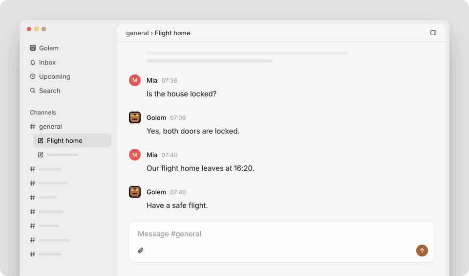

# Golem

A family AI assistant and second brain that runs on your own machine. One server in your home, one app for the whole
family on the web and the iPhone, and no cloud service between you and your data.

In Prague legend, Rabbi Loew shaped the Golem from clay to serve and protect his community. This one is made from
SQLite and Markdown.

<picture>
  <source media="(prefers-color-scheme: dark)" srcset="docs/assets/golem-demo-dark.gif">
  
</picture>

## Why Golem

- **One assistant for the family.** Everybody talks to the same Golem. It knows who writes each message, what each
  person wants, and what the family decided last week.
- **It remembers.** Each channel keeps a brief that Golem writes again when a conversation goes quiet. A learning
  loop keeps short facts about each person and how things are done. The family writes its own facts too. Golem reads
  all of it before every answer.
- **It does real work.** Golem runs commands on your Macs and Linux machines, reads your mail and calendar, controls
  the heating, orders the groceries, and browses the web. It asks before it sends, buys, or runs a destructive
  command.
- **It works on your computers.** Pair your Macs and Linux machines once, and Golem uses them as you would from a
  terminal. From your phone on the train: "start the photo backup on the home server and tell me when it is done".
  Golem starts the job on the server, the job keeps running when your phone sleeps, and Golem tells you when it ends.
- **It makes pages and small apps.** Ask for an invite, a poll, a packing list, or a game, and Golem builds it as an
  artifact that keeps its own data. Keep it for the family, or share a public link with anyone, while the rest of
  Golem stays private.
- **It stays quiet.** Background work tells a person only when they must act or asked to know. Golem makes no routine,
  reminder, or message that nobody asked for: it suggests one, and the suggestion waits until its person accepts it.
- **Your data stays with you.** One server, one SQLite database, Markdown files, and a search index that runs on the
  machine. Each person's own channels, machines, accounts, and places are private until they share them.

## How a conversation flows

<picture>
  <source media="(prefers-color-scheme: dark)" srcset="docs/assets/conversation-flow-dark.svg">
  
</picture>

- **The family has one workspace.** It holds channels, such as `#general`, `#home`, or `#travel`. A channel is open to
  every member, or private to one person.
- **A channel holds threads.** A thread is one conversation about one thing. Several people can write in it, and its
  agent knows who wrote each message. A thread that is done is settled; its files and artifacts stay in the channel.
- **Golem is your endless thread.** Each person has one thread with Golem that never ends: the **Golem** tab. It
  answers simple things itself and gives other work to the thread of the right channel, or starts one. The answer
  comes back to your Golem thread. A message passes between threads at most twice, so agents cannot talk to each other
  without end.
- **The endless thread does not get slow.** A memory tree of short summaries covers every message you can see. Old
  messages fold into it, and the agent opens a summary again with `zoom` when it needs the details.
- **The channel brief.** When a thread is quiet for 10 minutes, or settled, a background model writes the channel's
  brief again: its purpose, what is happening now, the decisions, the open questions, and what each person wants.
  Every thread of the channel starts from it.
- **Learned facts.** The learning loop reads the new messages and keeps only lasting facts about each person, such
  as their work, the people in their life, and what they do not eat, and how-tos for each channel; it skips the
  details of one task. It can also suggest a routine or a reminder. You see, change, and remove what it learned in
  Settings, and it does not learn a removed fact again.
- **Workspace facts.** The family writes facts about itself in Workspace settings: names, birthdays, addresses, work.
- **Recall.** Every message, file, note, and artifact goes into the search index. Agents look things up there with the
  `recall` tool before they say that they do not know.

The brief, the learned facts, the workspace facts, and the paired machines are prompt sections. A section keeps the
same text until its content changes, so the model's prompt cache stays warm.

## Under the hood

### Pi Durable

Agents run on [Pi Durable](https://github.com/earendil-works/pi), the durable agent runtime of Earendil. The workspace
has one Pi Durable session, and each thread is one conversation in it, with its transcript, runs, and tasks. A run that
a restart stopped continues when Golem starts again, and messages that came while Golem was off are caught up. A
tool that is safe to repeat, such as `send_to_thread`, runs again after a crash and finds the message it sent before.
The endless Golem thread compacts itself when its context gets long.

### Code mode

The model calls only a small set of core tools directly: channels, threads, files, `recall`, and web search. Every
other tool is in a namespace that the model uses from a short TypeScript script, in the code mode sandbox of
[Pi](https://github.com/earendil-works/pi) (`pi-codemode`, 256 MB, its own worker):

```ts
const events = await tools.google_calendar_events({ account: "home", from: "today", to: "sunday" });
const lights = await tools.home_assistant_states({ account: "home", domain: "light" });
return { events, lightsOn: lights.filter((light) => light.state === "on").length };
```

The namespaces are `hands_` (machines), `artifacts_`, `browser_`, `routines_`, `reminders_`, and one for each
connected integration, such as `google_` or `home_assistant_`. The agent finds tools with `describeNamespace()` and
`searchTools()`, so the prompt does not list hundreds of tools. One script can call many tools and return only what
matters, which keeps the context small.

### Hands and machines

Agents use your computers through [`hands`](hands/), a small daemon for macOS and Linux, written in Rust. Golem
never runs a model on a machine and never sends it a credential: the machine only does what the agent asks, as the
person who installed it. `hands` is Golem's copy of the `hands` daemon of
[Mycroft](https://github.com/dontpanicv/mycroft), built on the pi-env daemon of [Pi](https://github.com/earendil-works/pi).

<picture>
  <source media="(prefers-color-scheme: dark)" srcset="docs/assets/machines-dark.svg">
  
</picture>

- **Pairing.** **Add machine** in your own Settings shows one command, with a code of 16 letters that works once,
  for 10 minutes. Paste it into a terminal on the Mac or the Linux machine. The script downloads the binary for that
  system over HTTPS pinned to Golem's TLS key, checks its SHA-256, and runs `golem-hands install --pair`. That installs
  `hands` as a user service (launchd on a Mac, systemd on Linux) and sends Golem the machine's name, addresses, port,
  and the SHA-256 of its certificate. Golem answers with your Ed25519 public key, which Golem derives from its secret
  key, one for each person. From then on the machine trusts that key, and Golem trusts that certificate. On a Mac,
  `install` then walks you through the permissions, one at a time: Accessibility, Screen Recording, the Desktop,
  Documents, and Downloads folders, Local Network, and optionally Full Disk Access.
- **Transport.** The machine listens on one port: WebSocket over TLS 1.3 ([rustls](https://github.com/rustls/rustls)
  and [tungstenite](https://github.com/snapview/tungstenite-rs)), with a self-signed ECDSA P-256 certificate. Golem
  connects to every address of the machine at once (its LAN address, its VPN address, its hostname) and keeps the
  first that authenticates, with the certificate pinned. The machine sends a fresh nonce; Golem signs it, with the hash of
  the certificate, with your Ed25519 key. Until the signature checks out, the machine accepts nothing else, and the
  handshake must end within 10 seconds. After that, each WebSocket message is one binary frame of pi-env's protocol:
  `exec`, `open`, `pread`, `write`, `close`, `listFiles`, and the `job.*` operations.
- **The daemon.** For each connection, the listener starts its own `serve` process, so one crash ends only that
  connection. Commands of `exec` end with the connection. Long work is a **job** instead: a supervisor starts it in
  its own process group, writes its output and exit code to disk, and keeps it running when the connection drops or
  the supervisor restarts. Agents read its output later, wait for it, or cancel it. Finished jobs stay for 7 days. The
  service gets the `PATH` of your shell, so commands find `brew`, `npm`, `cargo`, or `gh` as your terminal does. The
  machine also announces itself over Bonjour (`_golem-hands._tcp`).
- **The network.** Golem connects to the machine, so the Golem server must reach it: on the same network, or over a
  VPN such as Tailscale or NetBird. `golem-hands install --bind <address>` limits the listener to one address, such
  as the VPN one. The machine needs no public address.
- **Tools.** Agents use the machine from code mode: `hands_exec` for a command, `hands_job_start`, `hands_job_wait`,
  and `hands_job_cancel` for long work, `hands_read`, `hands_write`, `hands_edit`, and `hands_list` for files, and
  `hands_copy_file` to put a file of the channel on the machine; `save_file` brings a result back.
- **Approvals.** Before a command that
  [dcg (destructive command guard)](https://github.com/Dicklesworthstone/destructive_command_guard) flags, such as
  `rm -rf` or `git push --force`, the agent waits until a person allows it: the person who paired the machine when the
  turn is somebody else's, or else the turn's own person. The question shows in the thread and comes as a push
  notification with Allow and Deny.
- **Who can use it.** A machine is private to your turns until you share it with every member. Several people can pair
  the same machine; it trusts each of their keys. `golem-hands unpair` takes a key away, also on open connections.
  Treat a paired machine as shell access for Golem, as the user who installed `hands`.

### Integrations

Each person connects their own accounts in Settings. An account is private to their turns until they share it, and
a person can connect several accounts of one service, such as a work and a home Google account. Agents send mail and
messages as a person only after that person allows each one. [docs/integrations.md](docs/integrations.md) has the
setup of each one.

| Integration | What agents do | How it connects |
| --- | --- | --- |
| Google (Gmail, Calendar, Drive) | Search and read mail, draft, send after approval, calendar, files | Google sign-in, through [gog](https://github.com/openclaw/gogcli) |
| Home Assistant | Read and control the home | Long-lived access token |
| Netatmo | Weather station and thermostat | Netatmo sign-in |
| Salus | Heating | Email and password ([salus-it500-cloud](https://github.com/Peterka35/salus-it500-cloud)) |
| Tesla | Car state, charging history, open the car after approval | Tesla Fleet API sign-in, [vehicle-command](https://github.com/teslamotors/vehicle-command) |
| Rohlík | Groceries | Rohlík's MCP server |
| Plaud | Recordings and their notes | Plaud's MCP server |
| Slack | Read and send after approval | A request of the Slack web app, pasted as cURL, through [slackcli](https://github.com/shaharia-lab/slackcli) |
| WhatsApp | Read and send after approval | A linked device, through [wacli](https://github.com/openclaw/wacli) |
| X | Read | Session cookies, through [Rettiwt-API](https://github.com/Rishikant181/Rettiwt-API) |
| Instagram | Read | Session cookie |

A connector is a file in `src/integrations/`. A connector with an MCP server gives its tools as they are, under its
namespace.

### Search and recall

The workspace has one search index, `index.sqlite`, on the server. The Search page of both apps and the agents'
`recall` tool use it, so a person and their agent find the same things.

- **What goes in.** The messages of every thread, the text of every artifact, and every file in the workspace and its
  channels:
  - documents (Markdown, Office, OpenDocument, mail, calendars, and more) in chunks of about 1800 characters;
  - PDFs page by page, where a scanned page is rendered as a picture and read with OCR;
  - pictures, at most 1024 pixels long, and screenshots with their OCR text;
  - audio in 30-second windows, without silence;
  - video as a frame every 3 seconds when the shot changes, plus its sound as audio.

  An answer card goes in as the words on the card. A file that Golem cannot read is still found by its name.
- **Words.** SQLite FTS5 with stemming finds the words of the query; a title counts three times as much as the text.
- **Meaning.** Google's [EmbeddingGemma 2](https://huggingface.co/ggml-org/embeddinggemma-2-GGUF) runs on the
  server, in a pinned [llama.cpp](https://github.com/ggml-org/llama.cpp) `llama-server` that Golem starts and stops.
  On the first start Golem downloads the text model (310 MB) and the picture and audio encoders (555 MB) and checks
  their SHA-256. Text that reads as prose, pictures, and audio all get a 768-dimension vector in **one shared space**,
  so a question in words finds a photo of a receipt or a voice memo, also when no word matches. The vectors are
  float16 rows in SQLite, compared by brute force: at family scale that takes milliseconds, with no vector database.
- **Ranking.** It follows [DigUp](https://github.com/ARahim3/DigUp). For each source, the best match of its vectors
  becomes a z-score against all the scores of the query, measured for each kind, because pictures and audio score on
  another scale than text. The share of query words that a source contains adds to it. A source shows when it stands
  out by meaning (z ≥ 3) or holds at least half of the words, so a search shows nothing rather than noise. A query of
  ids or numbers counts the words more.
- **Privacy.** Before it ranks, a search leaves out what its person may not see. A person finds the channels that every
  member sees, their own private channels, and their own Golem thread. An agent's `recall` sees what the person of its turn
  sees: in your Golem thread or private channel that is you, and in a shared channel it is the person whose message the
  agent answers.
- **Recall.** Agents call `recall` with a question in plain words, and get up to 20 results (8 by default), each with
  its kind, title, date, the link of its thread, and a snippet. They are told to recall before they say that they do
  not know.
- **The Search page.** Results come as you type, each with the Markdown lines around the first word that matches.
  Before a query, the page shows your recent searches and Golem.
- **Freshness.** Golem indexes a thread a second after it changes and checks the files every minute; it reads and
  embeds again only what changed. Until the model runs, search finds words only, and the Search page says so.

[docs/data.md](docs/data.md) has every file kind and the details.

### Artifacts

An artifact is a page or a small app that an agent writes in HTML: an invite with RSVPs, a poll, a shared shopping
list, a game, or a schedule to print or save as a PDF. It belongs to the channel of the thread that made it and
stays there when the thread is settled. The side panel of a thread shows the artifacts of its channel, and the iPhone
app shows them in the same way.

<picture>
  <source media="(prefers-color-scheme: dark)" srcset="docs/assets/artifacts-dark.svg">
  
</picture>

- **Members or public.** A new artifact is for members: only signed-in people who can see its channel open it, so an
  artifact of a private channel stays private. Any member who sees it, or an agent, can make it public; then anyone
  with its link opens it, without an account. A link is four words, such as `amber-fox-lake-moss`: easy to know again,
  and too many to guess. A name is never given out again, also after a delete.
- **Data without a backend.** The page keeps data through `golem`, a small runtime that Golem puts at its start:
  `golem.mine` for the records of one visitor, `golem.shared` for the records that everybody shares, and
  `golem.everyone` to list the records of all visitors, such as the answers of a poll. Visitors give their name with
  `golem.setName`. The records are rows in `golem.sqlite`; agents read and change them with `artifacts_data` and
  `artifacts_set_data`, and the side panel shows them under **Data**.
- **A sandbox, never Golem's origin.** The HTML runs in a frame without `allow-same-origin`, so it cannot read Golem's
  cookies or call Golem's API. Its content policy lets scripts come only from three public CDNs (jsDelivr,
  unpkg, and cdnjs), and styles and fonts also from Google Fonts. It blocks every network request
  (`connect-src 'none'`), so data goes only through `golem`. Golem serves a page that a person or an agent wrote only
  from its own `content` address, never from a path of the app.
- **The public host.** Public links use their own host, such as `a.example.com`, on the same Cloudflare Tunnel as
  Golem. Three layers keep the rest of Golem private: the tunnel lets through only `/<name>`, `/<name>/content`, and
  `/<name>/rpc` and answers `404` to everything else; Golem answers on that host only for public artifacts, and does
  not tell a members artifact from a missing one; and Golem listens only on `127.0.0.1`. An address that asks for 20
  links that do not exist in 10 minutes gets `429`. [docs/artifacts-sharing.md](docs/artifacts-sharing.md) has the
  setup.

### Reminders and routines at a place

"Remind me to buy milk when I leave work." "Remind Anna to take the umbrella when she gets to school." "Turn on the
heating at the cottage each time I leave work." A reminder can wait for a place instead of a time, and a routine can
run at a place instead of on a schedule; the iPhone tells Golem when it happens.

- **Places.** Each person marks their places on a map in their own Settings: a name, a pin, and a circle of 100 to
  5000 meters (iOS does not see a smaller circle reliably). The web app shows OpenStreetMap through Golem, so the
  browser never asks OpenStreetMap itself, and finds an address with OpenStreetMap's search; the iPhone uses Apple
  Maps. A place is private to its person's turns until they share it with every member.
- **The reminder.** The agent makes it with `reminders_create`: the text, the person to remind, a place by name, and
  `arrive` or `leave`. It uses the places of the person who asked, their own first and then the shared ones. The
  reminder waits in its thread and shows in the person's Upcoming, where they can cancel it.
- **The routine.** The agent makes it with `routines_create`: the instructions, a place by name, `arrive` or
  `leave`, and the person whose arrival or departure runs it. It runs each time that event comes, in its channel's
  thread, as a routine on a schedule does, but at most every 15 minutes, as a person at the edge of the circle goes in
  and out. It shows under "Routines at a place" in Upcoming, where the person pauses it.
- **The iPhone watches; Golem decides.** The iPhone is only a sensor. Golem gives it the places of its person's
  pending reminders and routines, one circle for each place however many wait there, and the app watches them with
  Core Location (`CLMonitor`), so iOS wakes it in the background when the person crosses a circle, also when the app
  does not run. The first such place asks for location access: iOS asks "While Using" first, and "Always" when the
  first event comes. The app tells Golem only "arrived at Cottage at 12:03" or "left Cottage", never where the person
  is, and Golem keeps only the last state at each place, with no history. Golem then decides what is due: the
  reminders and routines of that place, person, and event, a pause, and the 15 minutes between two runs.
- **A new reminder or routine.** A new reminder starts as "outside", so a person who is already at the place gets an
  arrival reminder at once. A new routine waits for the next crossing.
- **Golem reminds.** The reminder is due at once: its thread wakes, the agent writes the reminder, and it comes as a
  time-sensitive push. A second report of the same state changes nothing, and a cancelled reminder stays quiet.
- **Without a connection**, as in the mountains, the iPhone keeps each report with its time and sends it when it is
  online again; it also shows the reminders of that place itself. Golem still makes a late reminder due, but does not
  run a routine for a crossing that it hears of more than 15 minutes late.

### More

- **Browser.** Agents visit websites in a headless Chrome of their own for each thread and person, driven by Vercel's
  [agent-browser](https://github.com/vercel-labs/agent-browser). They search the web with ChatGPT's own search,
  because search engines block a headless browser. All their web traffic goes through one egress that blocks the
  server, the home network, and private addresses.
- **Routines and reminders.** Ask in plain words: "check the school system every morning", "remind me when I leave
  work". A routine is a schedule or [a place](#reminders-and-routines-at-a-place), instructions, and an optional
  script that collects what is new; when the script finds nothing, the run ends without the model. A reminder is at a
  time or [at a place](#reminders-and-routines-at-a-place).
- **Upcoming and suggestions.** Upcoming shows your routines, reminders, approvals, and the suggestions that wait for
  you. Accept a suggestion and it becomes a routine or a reminder.
- **The model.** Golem uses ChatGPT, signed in once with the device login of OpenAI's Codex. The server's owner
  chooses the model and the effort for everybody.

## The apps

The web app and the iOS app do the same things, with one design system modeled on Linear. Both talk to the JSON API
in [docs/api.md](docs/api.md).

- **Web.** A React single-page app that keeps its data local, shows each change at once, and stays current over
  server-sent events. It opens on what it showed last, also before the server answers.
- **iPhone.** A native SwiftUI app with the navigation of Slack's iOS app and the look of Linear's.
  - **Push notifications** with Reply, Snooze, and Done, and Allow or Deny for an approval, also on the Apple Watch.
    Siri reads a message aloud and sends your spoken reply.
  - A **Live Activity** shows the work for your message on the Lock Screen and in the Dynamic Island.
  - The **Share** extension sends a link, text, pictures, or files to Golem.
  - **Places** on a map start [reminders and routines when you arrive or leave](#reminders-and-routines-at-a-place).
  - **Voice, on the device:** dictation in every composer, and a hands-free conversation with Golem
    ([below](#voice-on-the-iphone)).

You build the iOS app yourself with Xcode and install it on your family's iPhones. It is not in the App Store.

### Voice on the iPhone

Everything that hears or speaks runs on the iPhone itself, on its Neural Engine. No audio leaves the phone: Golem
gets only the text, and the thinking happens on the server, with ChatGPT, as for a typed message.

| Job | Model | Runs with |
| --- | --- | --- |
| Speech to text | [Parakeet Ultra](https://huggingface.co/moondream/parakeet-ultra), 25 European languages, Czech and English among them; it tells the language by itself | [FluidAudio](https://github.com/FluidInference/FluidAudio) and Core ML |
| Text to speech | [Supertonic-3](https://huggingface.co/Supertone/supertonic-3), in Czech or English, for each sentence the language it is in | FluidAudio and Core ML |
| Is this speech? | Apple's built-in sound classifier (SoundAnalysis) | iOS, nothing to download |
| Echo cancellation | Apple's voice processing of the audio engine | iOS |

The two models are in the app (about 630 MB and 170 MB; `ios/scripts/fetch-*.sh` downloads them before the build),
so they work without a connection and nothing is downloaded on the phone.

- **Dictation.** Hold the mic in any composer and talk, then let go to send. Slide left to cancel, or slide up or tap
  to keep it listening. The words show in the field as you talk: Parakeet transcribes everything said again every
  second and at every pause, so the text comes in short steps, and the final text is one pass over all of it. Only
  what the sound classifier calls speech is transcribed, so a fan or typing never turns into "Thank you." The Action
  button, Siri, and Shortcuts can start it too: **Dictate to Golem** opens your Golem thread with the mic on, and
  **Ask Golem** sends a question with a screenshot and the clipboard without opening the app, and the answer comes
  as a notification.
- **Conversation.** The wave button in a thread starts a hands-free conversation. The microphone stays on with echo
  cancellation. A pause ends your turn: a short one after a finished sentence, a longer one after "and…", "um", or a
  comma, in Czech and English. Your words go to the thread as a voice message, which tells the agent to answer as
  people speak: plain sentences, one to three of them, and one short sentence before it uses a tool. Golem says each
  sentence as it streams in: Supertonic makes a sentence while the one before it plays, in 80 ms buffers.
- **Cutting in.** With headphones, your voice stops Golem at once, and what it did not say yet is dropped. On the
  iPhone's speaker, echo cancellation leaves enough of Golem's own voice to sound like words, so only "stop", "wait",
  and the like cut in there; a tap on the orb always does. What the microphone hears while Golem speaks is never sent.
- **It keeps going.** A conversation goes on with the screen locked and when you leave the thread's screen. Ending it
  stops the microphone and the voice, never the work: the agent finishes, and the answer is in the thread.

## Self-hosting

### What you need

- **A Mac with Apple silicon**, such as a Mac mini, that stays on. Linux on x86-64 or arm64 also works for the server.
- **[Bun](https://bun.sh)**, and these tools, which Golem checks before it starts:
  `brew install ffmpeg poppler tesseract dicklesworthstone/tap/dcg cloudflared`.
- **[Rust](https://rustup.rs)**, to build the `hands` binaries that Golem gives to the machines that pair:
  `rustup target add aarch64-apple-darwin x86_64-apple-darwin x86_64-unknown-linux-musl aarch64-unknown-linux-musl`,
  and for the Linux binaries on a Mac, `brew install zig && cargo install --locked cargo-zigbuild`.
- **A domain on Cloudflare**, for the tunnel and the HTTPS address. Google sign-in needs `https` on a public name.
- **A Google Cloud project** for Google sign-in. Nobody can sign in with a password.
- **A ChatGPT account** for the model.
- **Optional:** an Apple Developer account and Xcode for the iPhone app and its push notifications, and `gog`,
  `slackcli`, `wacli`, or `tesla-control` for those integrations.

### Run it

```sh
git clone https://github.com/dontpanicv/golem.git && cd golem
bun install
bunx --bun agent-browser install   # Chrome for the agents' browser, if Google Chrome is not installed
hands/scripts/build-release.sh     # the hands binaries for macOS and Linux
bun start                          # makes config/golem.toml on the first start, then stops
```

Fill in `config/golem.toml` and start Golem again:

```toml
base_url = "https://golem.example.com"
allowed_emails = ["you@example.com", "partner@example.com"]   # the first one is the server's owner

[google]
client_id = "….apps.googleusercontent.com"
client_secret = "…"
```

[google-sign-in.md](google-sign-in.md) shows how to make the Google client. Then sign in, connect ChatGPT in
Settings, and add the other members in Workspace settings. Each person adds their own machines and accounts in their
Settings.

Golem keeps everything in two folders ([docs/data.md](docs/data.md)). `GOLEM_CONFIG` and `GOLEM_DATA` move them.

- `config/`: `golem.toml` and `secret.key`. Keep a copy of it safe and apart from the data backups.
- `data/`: the database, the threads, the files, the search index and its model, and the logs. Back it up offsite.

### The recommended deployment: a Mac mini behind a Cloudflare Tunnel

This setup opens no port on your router and keeps the server off the internet:

1. **Golem listens only on `127.0.0.1:3000`**, which is the default `host` in `config/golem.toml`.
2. **`cloudflared` connects out to Cloudflare** and brings the traffic for `golem.example.com` to `127.0.0.1:3000`.
   Cloudflare holds the TLS certificate. There is no open port, no dynamic DNS, and no reverse proxy to keep up to
   date.
3. **Only the people in `allowed_emails` can sign in**, with Google.
4. **Public artifact links use a second host**, such as `a.example.com`, on the same tunnel. Its ingress lets through
   only the paths of an artifact, and Golem answers there only for public artifacts (see [Artifacts](#artifacts)).

Make a tunnel in the Cloudflare dashboard (Zero Trust › Networks › Tunnels) with these public hostnames, and save its
token in `config/share-tunnel.token`:

| Hostname | Path | Service |
| --- | --- | --- |
| `golem.example.com` | | `http://127.0.0.1:3000` |
| `a.example.com` | `^/[a-z]+(-[a-z]+){1,3}(/content\|/rpc)?$` | `http://127.0.0.1:3000` |
| | everything else | `http_status:404` |

Then install both services, which start at login and restart when they stop:

```sh
scripts/install-service.sh         # Golem, as the LaunchAgent dev.golem.server; logs in data/logs/golem.log
scripts/install-share-tunnel.sh    # cloudflared, as the LaunchAgent dev.golem.share
```

Set `share_url = "https://a.example.com"` in `config/golem.toml`. In the Cloudflare zone, turn off Email
Obfuscation, because it breaks the app's content policy, and do not cache the Golem host except `/app/` and
`/assets/`. `sudo scripts/install-service.sh --daemon` runs Golem from boot, before anyone logs in.

To update: `git pull && bun install`, then the restart command that `install-service.sh` printed, such as
`launchctl kickstart -k gui/$(id -u)/dev.golem.server`. Golem builds the web app when it starts.

### The iPhone app

```sh
brew install xcodegen
ios/scripts/fetch-parakeet.sh      # ~630 MB, the dictation model
ios/scripts/fetch-supertonic.sh    # ~170 MB, the voice
cd ios && xcodegen generate && open Golem.xcodeproj
```

Put your values in `ios/Config/Local.xcconfig`, which git ignores: `DEVELOPMENT_TEAM`, `GOLEM_BUNDLE_ID`,
`GOLEM_SERVER_URL` (`https://golem.example.com`), and `GOLEM_ASSOCIATED_DOMAIN` (`golem.example.com`). On the server,
set `ios_app_id = "<DEVELOPMENT_TEAM>.<GOLEM_BUNDLE_ID>"`, so that Google sign-in returns to the app. For push
notifications, add an APNs key as `config/apns.p8` and its `[apns]` table (`key_id`, `team_id`, `topic`).

### Let your agent set it up

Paste this prompt into a coding agent, such as Claude Code or Codex, on the Mac that will run Golem:

```text
Set up Golem (https://github.com/dontpanicv/golem) on this Mac as a self-hosted server for my family.

1. Read README.md, google-sign-in.md, docs/artifacts-sharing.md, and docs/integrations.md first.
2. Check that this is a Mac with Apple silicon. Install what is missing with Homebrew: bun, ffmpeg, poppler,
   tesseract, dicklesworthstone/tap/dcg, cloudflared, rustup (then a stable Rust), zig, and cargo-zigbuild.
3. Clone the repository to ~/golem, run `bun install`, `bunx --bun agent-browser install`, and
   `hands/scripts/build-release.sh`.
4. Run `bun start` once, so Golem writes config/golem.toml, and stop it.
5. Ask me for: the Golem hostname (such as golem.example.com), the artifact hostname (such as a.example.com),
   and the Google emails of the family, the owner first. Write base_url, allowed_emails, and share_url into
   config/golem.toml. Keep host = "127.0.0.1".
6. Guide me through the Google OAuth client of google-sign-in.md, with the redirect URI
   https://<golem hostname>/api/auth/callback/google, and write client_id and client_secret into config/golem.toml.
   I do the steps in the Google Cloud console myself.
7. Guide me to make a Cloudflare Tunnel with the two public hostnames of the README (the artifact host with its
   path rule, and a 404 for everything else), and to save its token in config/share-tunnel.token.
8. Run scripts/install-service.sh and scripts/install-share-tunnel.sh. Check that https://<golem hostname>
   opens Golem and that data/logs/golem.log shows no requirement that is missing.
9. Tell me to sign in, connect ChatGPT in Settings, and add the family in Workspace settings.

Never print, commit, or send the secrets in config/. Stop and ask me before any step that you cannot undo.
```

## Development

```sh
bun run dev        # http://localhost:3000, rebuilds the web app on every change
bun test
bun run typecheck
bun run lint       # Ultracite (Biome); `bun run format` fixes what it can
bun run lint:ios   # SwiftLint (`brew install swiftlint`)
```

- `src/` is a modular monolith: one module for each domain, each with its service, routes, and tests
  ([docs/modular-monolith.md](docs/modular-monolith.md)). `web/` has the same modules.
- `design/tokens.json` holds every color, size, space, radius, and shadow; `bun run tokens` makes the CSS and the
  Swift tokens from it. `design/components.md` is the spec of every component, on the web and on iOS.
- `design/icon.svg` is Golem's face: the clay golem in an 8 × 8 grid, with the aleph of אמת (truth), the letter that
  gives it life, as the dark cell on its forehead.
- `.claude/skills/` has the agent skills of this repository, such as
  [Stageshow](https://github.com/benjitaylor/skills), which made the demo above
  (`.claude/skills/stageshow/examples/golem-demo/`). The diagrams are made with
  [Archify](https://github.com/tt-a1i/archify) from `docs/assets/*.archify.json`.

## Credits

Golem stands on the work of these projects and people:

- **Agents:** [Pi](https://github.com/earendil-works/pi) by Earendil (Pi Durable, Pi Codemode, Pi AI, and Chord);
  the `hands` daemon of [Mycroft](https://github.com/dontpanicv/mycroft); the memory tree follows
  [UniiChat](https://github.com/VictorTaelin/UniiChat); the search ranking follows
  [DigUp](https://github.com/ARahim3/DigUp); web search follows [pi-web-access](https://github.com/nicobailon/pi-web-access);
  [destructive_command_guard](https://github.com/Dicklesworthstone/destructive_command_guard);
  [agent-browser](https://github.com/vercel-labs/agent-browser); the
  [Model Context Protocol SDK](https://github.com/modelcontextprotocol/typescript-sdk).
- **Server:** [Bun](https://bun.sh), [TypeScript](https://www.typescriptlang.org), [Effect](https://effect.website),
  [SQLite](https://sqlite.org), [better-auth](https://www.better-auth.com), [llama.cpp](https://github.com/ggml-org/llama.cpp),
  [FFmpeg](https://ffmpeg.org), [Poppler](https://poppler.freedesktop.org),
  [Tesseract](https://github.com/tesseract-ocr/tesseract), [unpdf](https://github.com/unjs/unpdf), and
  [Cloudflare Tunnel](https://github.com/cloudflare/cloudflared).
- **Web:** [React](https://react.dev), [TanStack Router, Query, and DB](https://tanstack.com),
  [Radix](https://www.radix-ui.com), [react-markdown](https://github.com/remarkjs/react-markdown),
  [Shiki](https://shiki.style), [Leaflet](https://leafletjs.com) with [OpenStreetMap](https://www.openstreetmap.org),
  [Chart.js](https://www.chartjs.org), [docx-preview](https://github.com/VolodymyrBaydalka/docxjs), and
  [read-excel-file](https://gitlab.com/catamphetamine/read-excel-file).
- **iOS:** SwiftUI, [XcodeGen](https://github.com/yonaskolb/XcodeGen), and
  [FluidAudio](https://github.com/FluidInference/FluidAudio).
- **Integrations:** [gog](https://github.com/openclaw/gogcli), [wacli](https://github.com/openclaw/wacli),
  [slackcli](https://github.com/shaharia-lab/slackcli), [Rettiwt-API](https://github.com/Rishikant181/Rettiwt-API),
  [vehicle-command](https://github.com/teslamotors/vehicle-command),
  [salus-it500-cloud](https://github.com/Peterka35/salus-it500-cloud), and TeslaMate for the charging log.
- **Models:** [EmbeddingGemma 2](https://huggingface.co/ggml-org/embeddinggemma-2-GGUF) by Google (Apache 2.0);
  [Parakeet Ultra](https://huggingface.co/moondream/parakeet-ultra) by Moondream (CC-BY-4.0), built on NVIDIA's
  Parakeet TDT 0.6B v3 (CC-BY-4.0); [Supertonic-3](https://huggingface.co/Supertone/supertonic-3) by Supertone
  (BigScience Open RAIL-M, with use restrictions); the Core ML conversions of both are by FluidInference.
- **Design:** the look of [Linear](https://linear.app), the navigation of Slack's iOS app, the layout of
  [T3 Code](https://github.com/pingdotgg/t3code), and the [Inter](https://rsms.me/inter/) font (SIL Open Font
  License).
- **Tools for this repository:** [Stageshow](https://github.com/benjitaylor/skills) by Benji Taylor (MIT) and
  [Archify](https://github.com/tt-a1i/archify).

## Status

Golem runs our family every day. It is early, it changes often, and we build it in public.
